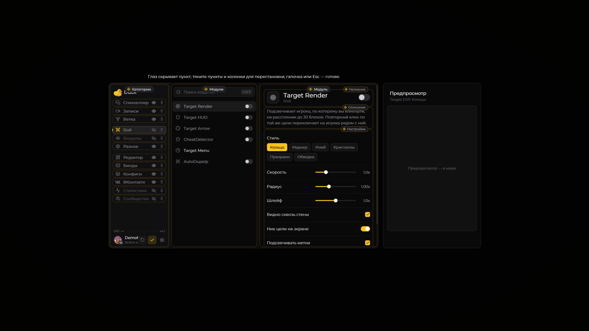
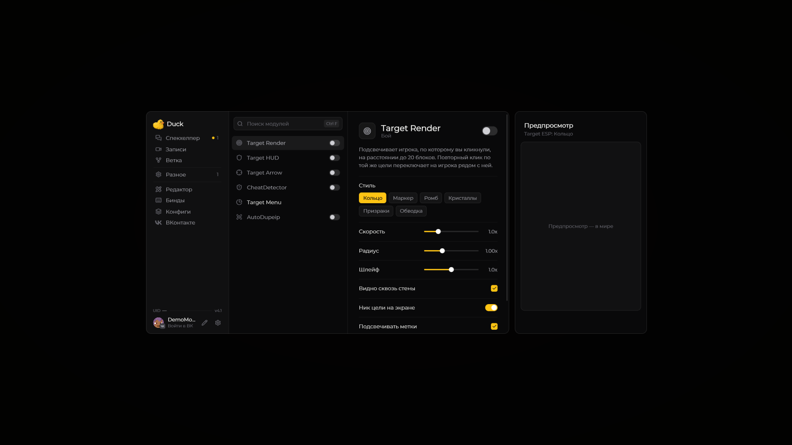

# Главное меню

Нажмите **Right Shift**, чтобы открыть меню Duck Util. Если клавиша занята, измените её в **Настройки → Управление → Назначение клавиш**.

## Навигация

Выберите раздел в боковом меню, чтобы открыть его страницу. Здесь можно включать модули, менять их параметры и переходить к HUD и другим функциям. Для работы по сменам откройте [Спекхелпер](spec-helper.md).

Наведите курсор на незнакомую настройку: рядом появится подсказка, если она доступна. Нажмите **Esc** или кнопку закрытия, чтобы вернуться в игру.

## Скрыть разделы · 4.1

Нажмите **карандаш рядом с профилем**. Возле каждого пункта слева появятся **глаз** и **шесть точек**:

* **Глаз** скрывает пункт в обычном меню. Можно скрыть «Бой», «Визуалы», «Статистику», «Сообщество» и другие разделы.
* Скрытые пункты видны во время редактирования с **зачёркнутым глазом**. Нажмите его, чтобы вернуть пункт.
* **Шесть точек справа** сохраняют перетаскивание. Глаз расположен отдельно левее и не начинает перенос.

Нажмите **галочку, Enter или Esc**, чтобы закончить. Скрытие и порядок сохраняются в конфиге. Сам модуль, его HUD и бинды продолжают работать. Даже если скрыты все пункты, карандаш остаётся доступен. Сброс раскладки возвращает стандартный порядок и видимость всех разделов.

