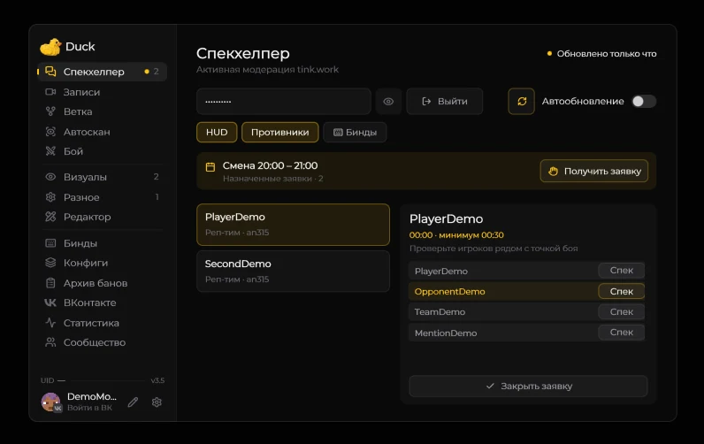

# Главное меню

Нажмите **Right Shift**, чтобы открыть меню Duck Util. Если клавиша занята, измените её в **Настройки → Управление → Назначение клавиш**.

## Навигация

Выберите раздел в боковом меню, чтобы открыть его страницу. Здесь можно включать модули, менять их параметры и переходить к HUD и другим функциям. Для работы по сменам откройте [Спекхелпер](spec-helper.md). Локальные журналы доступны в [«Архиве банов»](report-screen.md).

Наведите курсор на незнакомую настройку: рядом появится подсказка, если она доступна. Нажмите **Esc** или кнопку закрытия, чтобы вернуться в игру.
