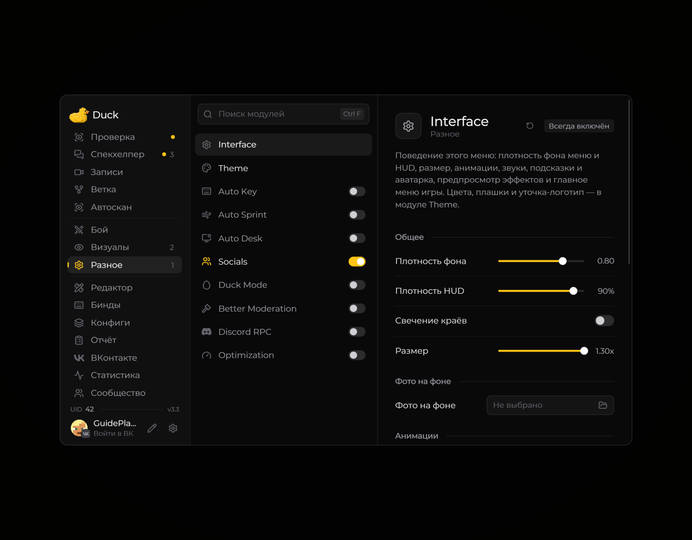

# Главное меню

Нажмите **Right Shift**, чтобы открыть меню Duck Util. Если клавиша занята, измените её в **Настройки → Управление → Назначение клавиш**.

<!-- screenshots-3.3 -->
<figure><figcaption>
Главное меню: разделы, модули и настройки · Duck Util 3.3.
</figcaption></figure>
<!-- /screenshots-3.3 -->

## Навигация

Выберите раздел в боковом меню, чтобы открыть его страницу. Здесь можно включать модули, менять их параметры и переходить к HUD и другим функциям.

Наведите курсор на незнакомую настройку: рядом появится подсказка, если она доступна. Нажмите **Esc** или кнопку закрытия, чтобы вернуться в игру.
