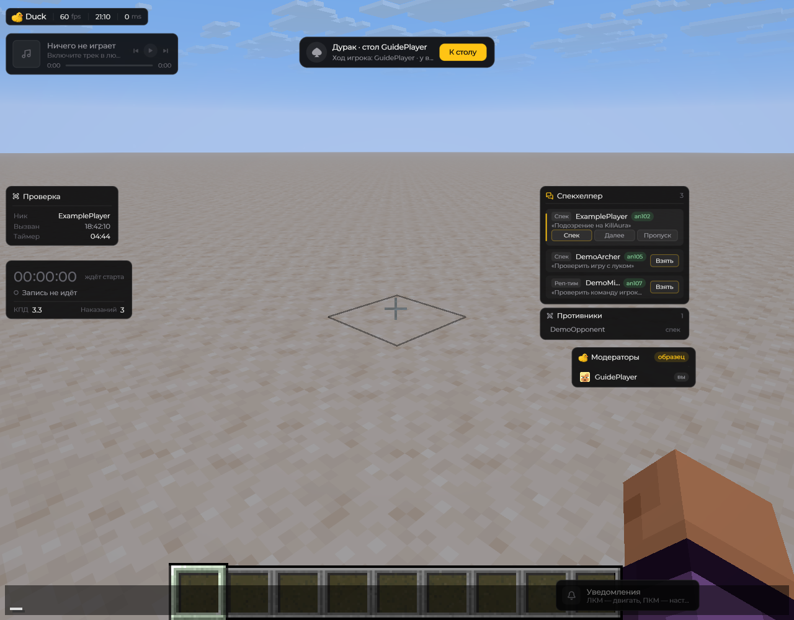
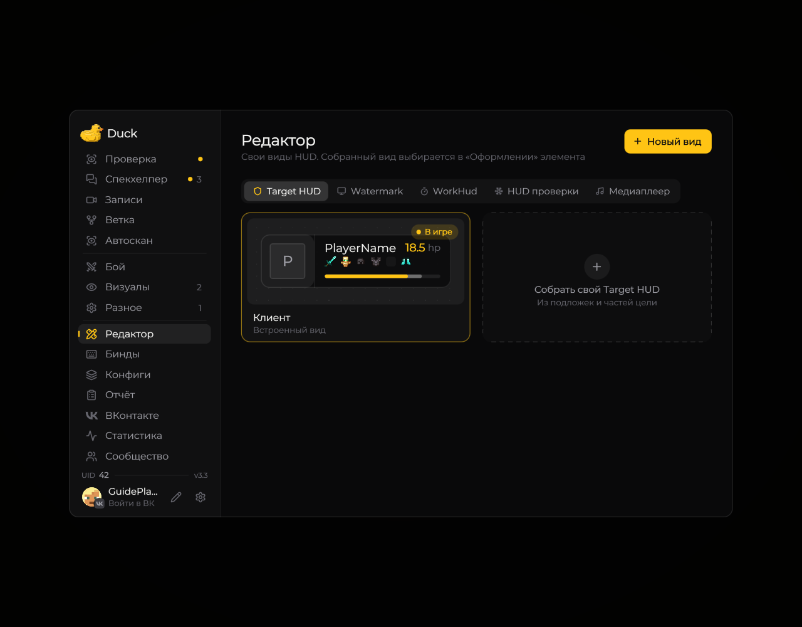
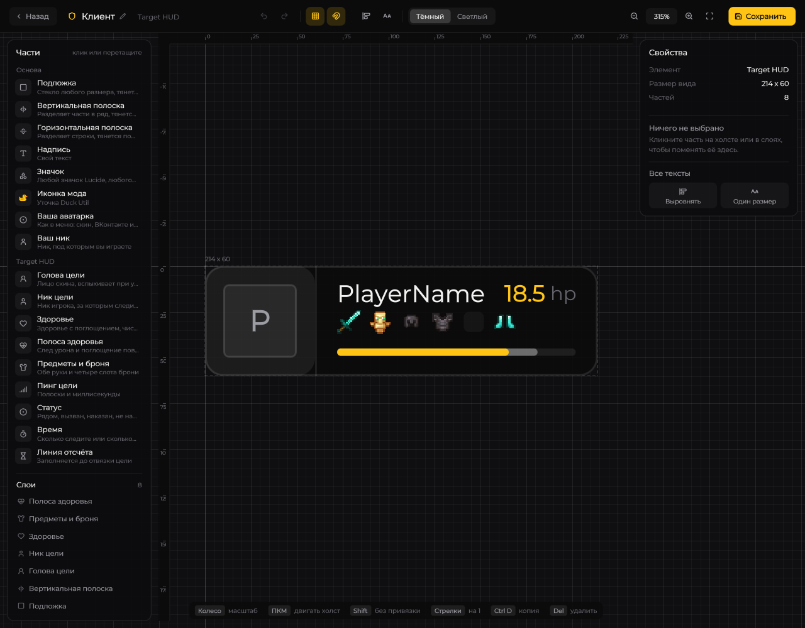
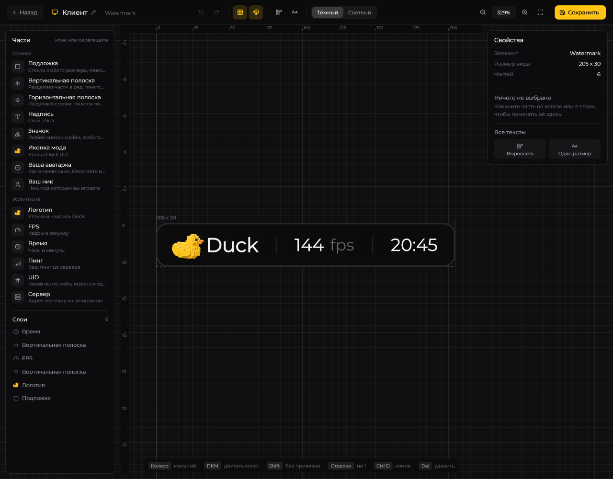

# Редактор HUD

В Duck Util можно двигать готовые панели и создавать собственный вид элементов. Это два способа настройки одного HUD.

## Расположить готовые панели

Откройте игровой чат. **ЛКМ** — перетащить панель, **ПКМ** — открыть её мини-настройки. Если элемента нет, включите его в настройках HUD или соответствующего модуля.

<figure><figcaption>
Расположение панелей в открытом чате · Duck Util 3.3. Демонстрационные данные.
</figcaption></figure>

## Создать свой вид

В меню **Right Shift → Редактор** выберите элемент: Target HUD, Watermark, WorkHud или медиаплеер. Нажмите **Новый вид**, задайте название и начните со встроенного шаблона или пустого холста.

<figure><figcaption>
Страница «Редактор»: виды выбранного элемента · Duck Util 3.3.
</figcaption></figure>

В полноэкранном редакторе слева находятся части и слои, в центре — холст, справа — свойства выбранной части. Колесо меняет масштаб, **ПКМ** или **Пробел** со сдвигом перемещает холст. **Shift** временно отключает прилипание.

<figure><figcaption>
Редактор собственного вида Target HUD · Duck Util 3.3.
</figcaption></figure>

**Ctrl+Z / Ctrl+Y** — отмена и повтор. Нажмите **Сохранить** или **Ctrl+S**, чтобы сохранить вид. При выходе с несохранёнными правками появится вопрос. Затем выберите созданный вариант в настройке **Оформление** соответствующего элемента.

Пример другого элемента — Watermark

<figure><figcaption>
Редактор Watermark · Duck Util 3.3.
</figcaption></figure>

Часть WorkHud «Наказания» удалена вместе с системой отчётов. При загрузке старого собственного вида эта часть пропускается; остальные элементы сохраняются.
