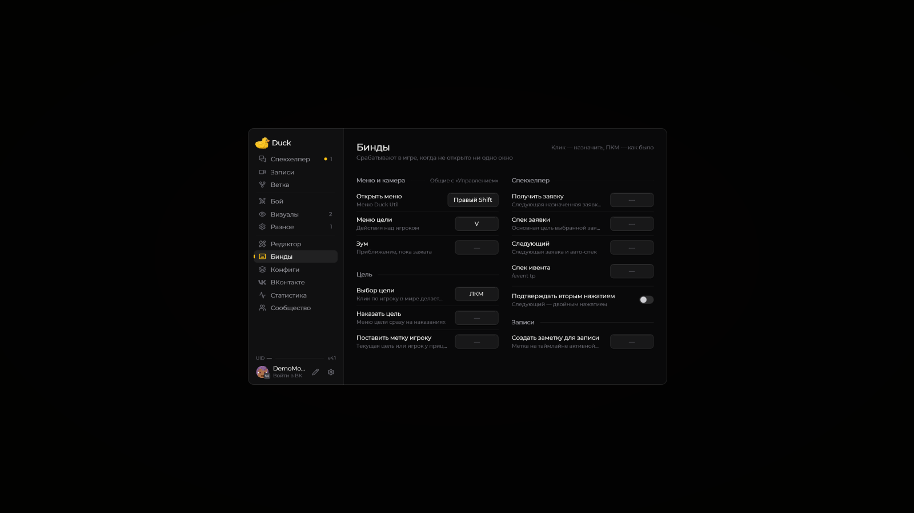

# Клавиши

| Клавиша по умолчанию | Действие                             |
| -------------------- | ------------------------------------ |
| **Right Shift**      | Открыть меню Duck Util               |
| **V**                | Открыть меню действий с целью в игре |

<figure><figcaption>
Все клавиши мода на странице «Бинды» · Duck Util 3.3.
</figcaption></figure>

У некоторых модулей есть собственные привязки. Например, клавишу зума можно назначить в настройках модуля **Zoom**; по умолчанию она не задана.

## Изменить клавишу

Откройте **Настройки → Управление → Назначение клавиш** в Minecraft, найдите Duck Util и выберите нужную привязку. Если одинаковая клавиша назначена нескольким действиям, Minecraft покажет конфликт.

Клавиша **V** открывает меню цели, когда вы находитесь в мире. Если меню не появляется, проверьте, что вы вошли в мир и клавиша не занята другим действием.

## Спекхелпер смены

Назначьте клавиши в **Right Shift → Бинды → Спекхелпер**. По умолчанию эти действия не назначены:

* **Получить заявку** — получить назначенную заявку подтверждённой смены.
* **Спек заявки** — спек основной цели выбранной заявки, как большая кнопка «Спек» в GUI. Выбранный связанный участник или глобальная цель не заменяют основной ник заявки.
* **Следующий** — закрыть текущую заявку, выбрать самую старую оставшуюся или получить новую, если очередь пуста. По умолчанию через **0,6 секунды** запускается спек следующей; поведение меняется в **Спекхелпер → шестерёнка**.
* **Спек ивента** — команда `/event tp`.

Кликните по полю привязки и нажмите клавишу, среднюю или боковую кнопку мыши. **Backspace/Delete** снимает привязку, **Esc** отменяет назначение. Совпадения подсвечиваются. Бинды работают в игре без открытых окон. Для «Следующий» можно включить подтверждение вторым нажатием; по умолчанию оно выключено.

