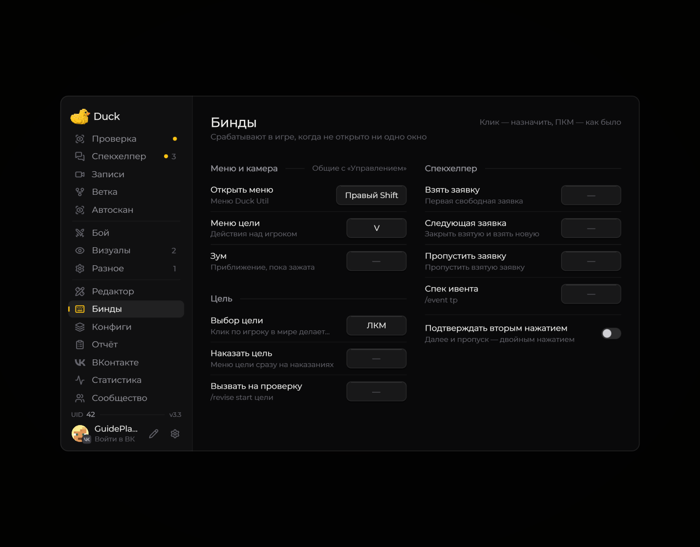

# Клавиши

| Клавиша по умолчанию | Действие                             |
| -------------------- | ------------------------------------ |
| **Right Shift**      | Открыть меню Duck Util               |
| **V**                | Открыть меню действий с целью в игре |

<figure><figcaption>
Все клавиши мода на странице «Бинды» · Duck Util 3.3.
</figcaption></figure>

У некоторых модулей есть собственные привязки. Например, клавишу зума можно назначить в настройках модуля **Zoom**; по умолчанию она не задана.

## Изменить клавишу

Откройте **Настройки → Управление → Назначение клавиш** в Minecraft, найдите Duck Util и выберите нужную привязку. Если одинаковая клавиша назначена нескольким действиям, Minecraft покажет конфликт.

Клавиша **V** открывает меню цели, когда вы находитесь в мире. Если меню не появляется, проверьте, что вы вошли в мир и клавиша не занята другим действием.

## Спекхелпер смены

Откройте **Right Shift → Бинды → Спекхелпер**. **«Получить заявку»** запрашивает назначенную вам заявку. **«Закрыть и далее»** запрашивает следующую после подтверждения закрытия текущей. Действия доступны, когда [Спекхелпер](spec-helper.md) видит подтверждённую смену.
