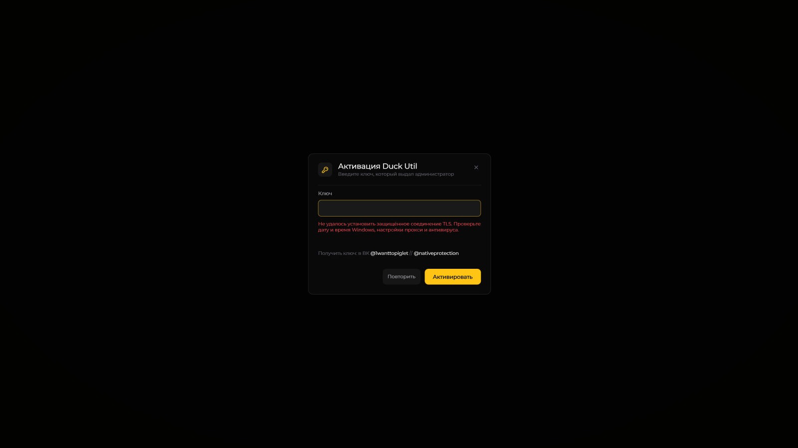

# Активация Duck Util

Для основных возможностей нужна активная лицензия. Вставьте выданный администратором ключ и нажмите **Активировать**.

В **3.3** сообщение помещается в несколько строк. Мод различает таймаут подключения, ожидание ответа, TLS, DNS, разрыв соединения, HTML вместо JSON и HTTP-ошибки. Следуйте подсказке именно вашего сообщения: повторный ввод ключа не исправляет, например, сбой TLS.

Если ключ не найден, заблокирован или привязан к другому компьютеру, обратитесь к выдавшему его администратору. Если версия устарела — установите свежую сборку.

Пример сообщения: ошибка защищённого соединения TLS

<figure><figcaption>
Ключ не введён. Нажмите на изображение для просмотра в полном размере.
</figcaption></figure>


[Разбор ошибок активации](../reshenie-problem/license-issues.md)


**Никому не отправляйте лицензионный ключ.** Для помощи достаточно версии мода и текста ошибки.
