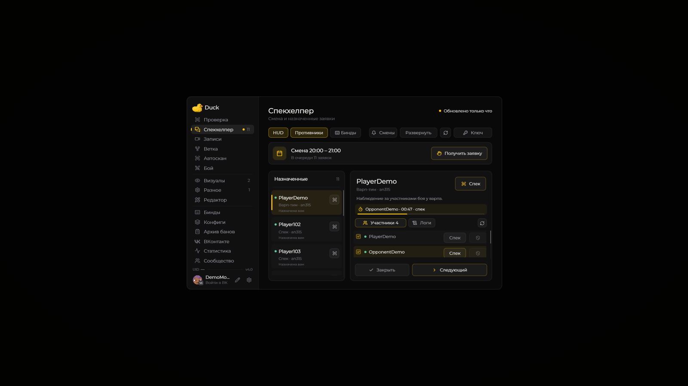

# Рабочие страницы меню

Левая колонка Duck Util ведёт к рабочим страницам. Подтверждённая смена и назначенные заявки находятся в Спекхелпере.

В **Спекхелпере → Развернуть** очередь, логи VK и участники доступны одновременно. В обычном меню между участниками и логами можно переключаться вкладками.

| Раздел                                | Для чего                                                       |
| ------------------------------------- | -------------------------------------------------------------- |
| [Проверка](check-screen.md)           | Сессия, переписка и быстрые ответы при включённом Old (revise) |
| [Спекхелпер](spec-helper.md)          | Смена, личная очередь, спек участников и логи VK               |
| [Записи](records-screen.md)           | Запись экрана и таймкоды                                       |
| [Ветка](branch-screen.md)             | Дерево связанных аккаунтов                                     |
| [Автоскан](auto-scan-screen.md)       | Поиск подозрительных игроков                                   |
| [Архив банов](report-screen.md)       | Локальные журналы наказаний                                    |
| [ВКонтакте](vk-screen.md)             | Вход и интеграция ВК                                           |
| [Статистика](stats-view.md)           | Календарь времени в игре                                       |
| [Сообщество](social-view.md)          | Модераторы и игровые действия                                  |
| [Конфиги](../vozmozhnosti/configs.md) | Профили и обмен по коду                                        |
| [Бинды](keybindings.md)               | Клавиши мода                                                   |
| [Редактор](hud-editor.md)             | Свои виды элементов HUD                                        |

## Новые бинды в 4.0

* **Цель → Поставить метку игроку** переключает метку выбранной цели или игрока у прицела.
* **Записи → Создать заметку для записи** ставит метку на таймлайне активной записи.

С **4.1** также доступен **Спекхелпер → Спек заявки** — спек основной цели выбранной заявки. Все эти клавиши назначаются вручную на странице **«Бинды»**.

В карандаше меню глаз скрывает любой раздел, а шесть точек меняют его порядок. Подробнее: [Главное меню](duck-screen.md).
