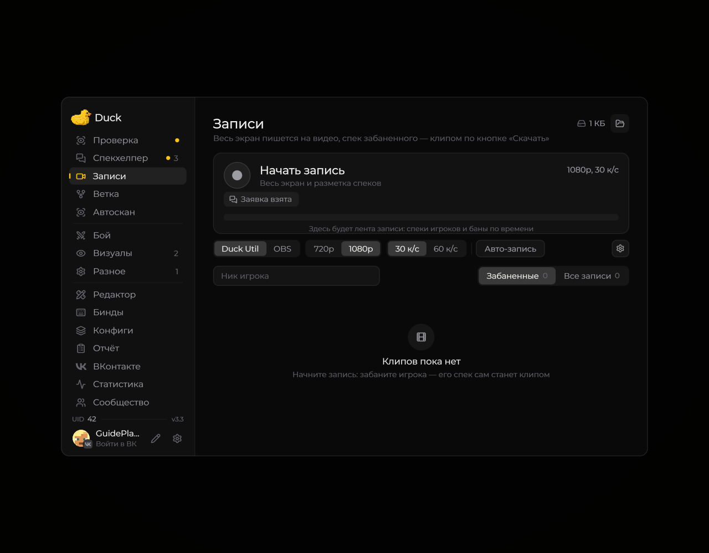

# Записи

Страница «Записи» объединяет настройки записи, историю файлов и таймкоды наблюдений и наказаний.

<figure><figcaption>
Страница «Записи» перед первой записью · Duck Util 3.3. Демонстрационные данные.
</figcaption></figure>

В верхней части можно начать или остановить запись, выбрать качество и частоту кадров. Поиск по нику помогает найти нужные отрезки. Во вкладках находятся наказания с таймкодами и записи целиком.

[Подробнее о записи экрана](../vozmozhnosti/records.md)
