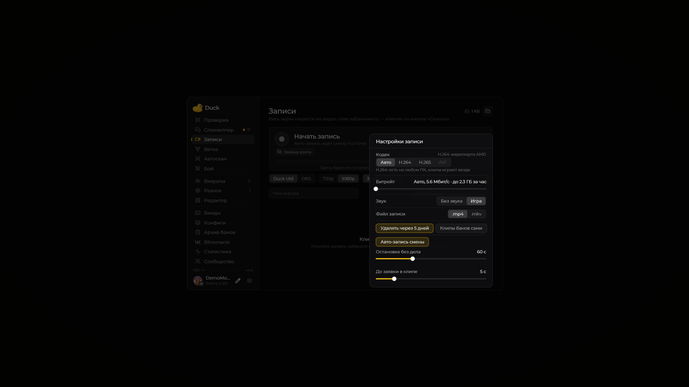
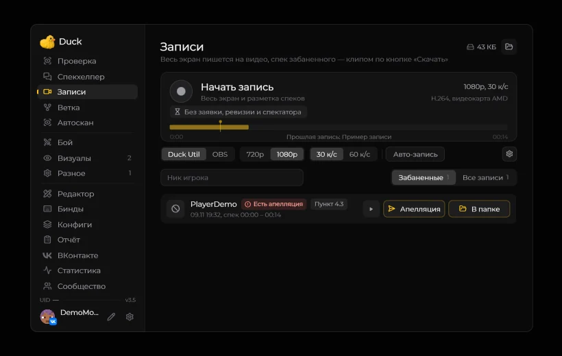

# Записи

Страница «Записи» объединяет настройки записи, историю файлов и таймкоды наблюдений и наказаний.

<figure><figcaption>
Страница «Записи» перед первой записью · Duck Util 3.3. Демонстрационные данные.
</figcaption></figure>

В верхней части можно начать или остановить запись, выбрать качество и частоту кадров. Поиск по нику помогает найти нужные отрезки. Во вкладках находятся наказания с таймкодами и записи целиком.

[Подробнее о записи экрана](../vozmozhnosti/records.md)

## Запись смены

В **Right Shift → Записи → шестерёнка** настройка **«Авто-запись смены»** включена по умолчанию. После подтверждения смены на tink.work и входа на FunTime мод начинает непрерывную запись. Она продолжается между заявками, после выхода из спека и при доработке оставшихся заявок после конца смены. При завершении смены нажмите **«Закончить запись»** в разделе **«Записи»**. Сессия сохраняется целиком, а переходы к игрокам добавляют таймкоды.

Если смена уже подтверждена, но мод её не показывает, обновите очередь в [Спекхелпере](spec-helper.md).

## Настройки обычной автозаписи

В **Записи → шестерёнка** доступны:

* **«Остановка без дела» — 0–180 секунд**, по умолчанию **60**. Управляет паузой перед остановкой обычной автозаписи; при нуле запись останавливается на первом тике бездействия. Ручную запись и непрерывную запись смены эта пауза не останавливает.
* **«До заявки в клипе» — 0–30 секунд**, по умолчанию **5**. Добавляет запас перед началом обычного спека. Для полных клипов заявок Спекхелпера используются точные границы разбора.

## Полные клипы заявок Спекхелпера

В новых записях 4.0 начало заявки отмечается при **первом подтверждённом переходе в спек** по её основной цели или любому участнику. Конец — когда мод получает подтверждение закрытия заявки либо замечает её исчезновение из личной очереди.

**Клип каждого участника включает весь этот разбор заявки.** Переключение между игроками и сам бан не обрезают его до отдельного спека или пяти секунд после бана. Кнопка **«Заявка идёт»** показывает, что окончательный клип ещё не готов; скачивание и апелляция доступны после закрытия.

Успешный бан кнопкой Спекхелпера отмечается в записи по ответу tink.work. Подтверждение **«\[♨] Ник забанен»** в игровом чате также учитывается, например после самостоятельного действия в браузере. Сам клик в браузере мод не получает. Если отметка бана не пришла, полный клип участника можно найти по нику на странице **«Записи»**.

**«Следующий» завершает клип только своей заявки.** Другие открытые заявки продолжают записываться. Доработка после конца смены не обрезает разбор.

Это разметка фактически записанного видео: при остановке записи или выходе доступен записанный фрагмент. Старые записи задним числом не получают границы заявки. Обычные ручные спеки и архивные ревизии сохраняют прежние правила; настройка **«До заявки в клипе»** не добавляет запас к новым полным клипам заявок.

## Ответ на апелляцию

На вкладке **«Забаненные»** и в результатах поиска записи по нику рядом со скачиванием клипа есть кнопка **«Апелляция»**. Она открывает выбранный клип и редактор с заготовкой `#рек НикИгрока`. Введите таймкоды и аргументацию в удобных строках. Заготовку можно полностью отредактировать или удалить.

**«Отправить»** передаёт все строки редактора с переносами и приватное видеовложение **одним сообщением** в диалог с FunTime Administration. Клип доступен в плеере VK после обработки. Для отправки нужен [подключённый ВКонтакте](vk-screen.md) с доступом к видео. При первой авторизации со старым ключом может потребоваться повторный вход.

В обновлённом окне 4.0 видео и текст размещены в отдельных панелях. Поле ответа стало шире, справа над ним показан счётчик до **4096 символов**. Кнопка **«Отправить»** закреплена внизу панели. Под видео находятся воспроизведение, звук, таймлайн и число заметок.

Если бот прислал уведомление об обжаловании, возле клипов с таким ником появляется **«Есть апелляция»** со значком восклицания. Новый ответ `#рек НикИгрока` из вашего аккаунта в этом диалоге снимает индикатор. Мод отслеживает новые сообщения и раз в минуту сверяет историю. При первом подключении проверяются последние 200 сообщений.

## Плеер и заметки

ЛКМ по шкале перематывает видео. Наведите курсор на цветную метку, чтобы увидеть таймкод, или нажмите на неё, чтобы перейти к моменту. Метки из записи переносятся на шкалу вырезанного клипа с учётом его отрезков. Встроенный плеер на Windows использует доступные системные кодеки. Оформление берёт акцент из **Interface**, включая украшения **New Year Mode**, если он включён.
