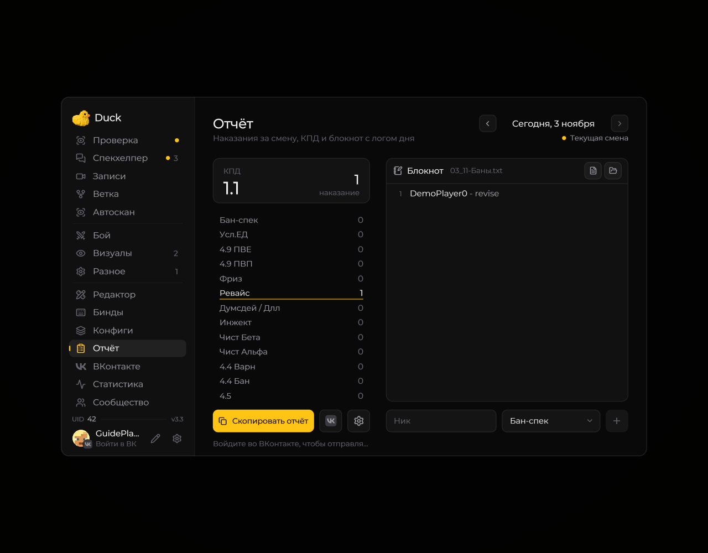

# Отчёт

На странице «Отчёт» находятся счётчики наказаний, КПД за смену и редактируемый список банов.

<figure><figcaption>
Отчёт: категории, КПД и журнал · Duck Util 3.3. Демонстрационные данные.
</figcaption></figure>

Выберите дату смены, проверьте записи и скопируйте подготовленный отчёт. Через шестерёнку настраиваются роль, начало смены, подсчёт и коэффициенты. Даты отчётов учитываются по московскому времени.

[Как категории попадают в отчёт](../vozmozhnosti/ban-system.md) · [Статистика](stats-view.md)
