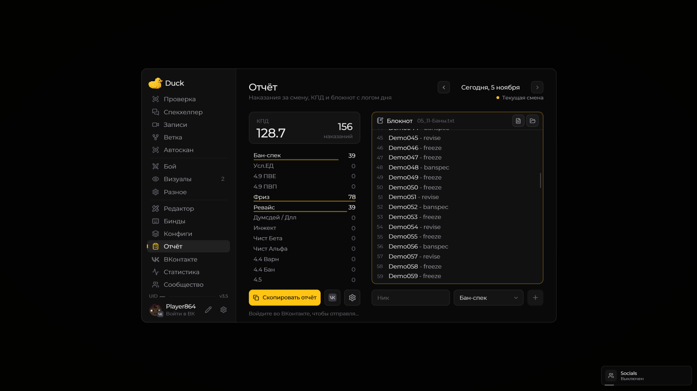

# Отчёт

На странице «Отчёт» находятся счётчики наказаний, КПД за смену и редактируемый список банов.

<figure><figcaption>
Отчёт · Duck Util 3.5. Демонстрационные данные, 156 строк.
</figcaption></figure>

Выберите дату смены, проверьте записи и скопируйте подготовленный отчёт. Через шестерёнку настраиваются роль, начало смены, подсчёт и коэффициенты. Даты отчётов учитываются по московскому времени.

[Как категории попадают в отчёт](../vozmozhnosti/ban-system.md) · [Статистика](stats-view.md)

## Блокнот и прокрутка

В **3.5** исправлен захват ползунка справа от списка ников. Удерживайте **ЛКМ** на ползунке и тяните вверх или вниз: содержимое сразу следует за мышью. Захват сохраняется и за пределами рамки; отпускание кнопки завершает прокрутку. Область нажатия шире видимой тонкой полоски.

Нажатие на свободную часть дорожки переносит ползунок к выбранному месту. Колесо мыши и выделение текста по строкам работают как прежде. Перетаскивание ползунка сохраняет положение текстового курсора, выделение и сами записи. Если все строки помещаются, полоса не показывается. При переключении дня захват сбрасывается.
