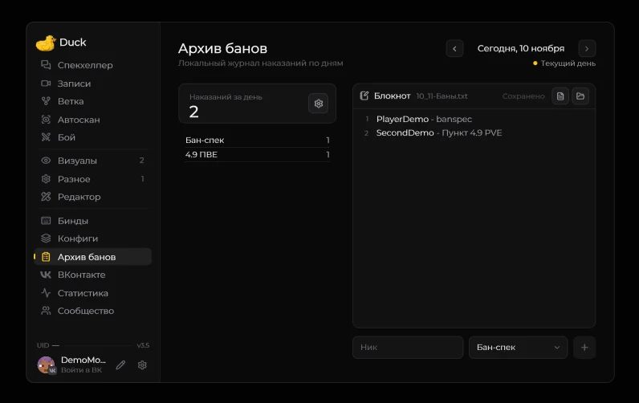

# Архив банов

Откройте **Right Shift → Архив банов**, чтобы посмотреть число наказаний и локальный журнал. Выберите дату стрелками и отредактируйте список в блокноте. Журналы хранятся в **Duck Util/Баны**, даты учитываются по московскому времени.

Через шестерёнку можно выбрать набор категорий для своей роли и настроить учёт наказаний.

[Как наказания попадают в архив](../vozmozhnosti/ban-system.md) · [Статистика](stats-view.md)

## Блокнот и прокрутка

В **3.5** исправлен захват ползунка справа от списка ников. Удерживайте **ЛКМ** на ползунке и тяните вверх или вниз: содержимое сразу следует за мышью. Захват сохраняется и за пределами рамки; отпускание кнопки завершает прокрутку. Область нажатия шире видимой тонкой полоски.

Нажатие на свободную часть дорожки переносит ползунок к выбранному месту. Колесо мыши и выделение текста по строкам работают как прежде. Перетаскивание ползунка сохраняет положение текстового курсора, выделение и сами записи. Если все строки помещаются, полоса не показывается. При переключении дня захват сбрасывается.
