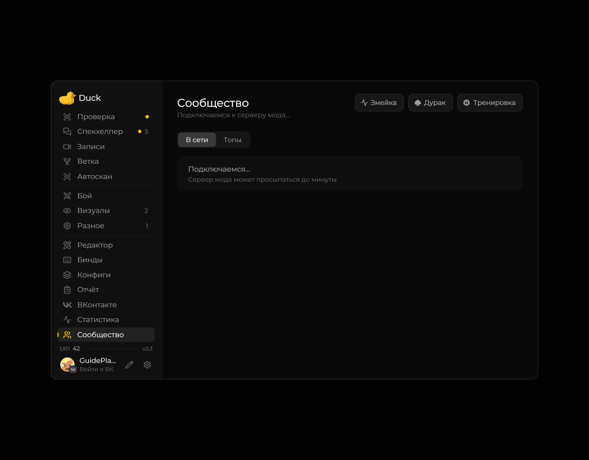

# Социальный экран

Социальный экран Duck Util собирает доступные социальные функции и игровые активности.

<!-- screenshots-3.3 -->
<figure><figcaption>
Сообщество: модераторы и игровые действия · Duck Util 3.3. Демонстрационные данные.
</figcaption></figure>
<!-- /screenshots-3.3 -->

Откройте его из главного меню и выберите нужный раздел. Данные и приглашения могут не отображаться, если сервис временно недоступен или для функции не выполнены условия подключения.
