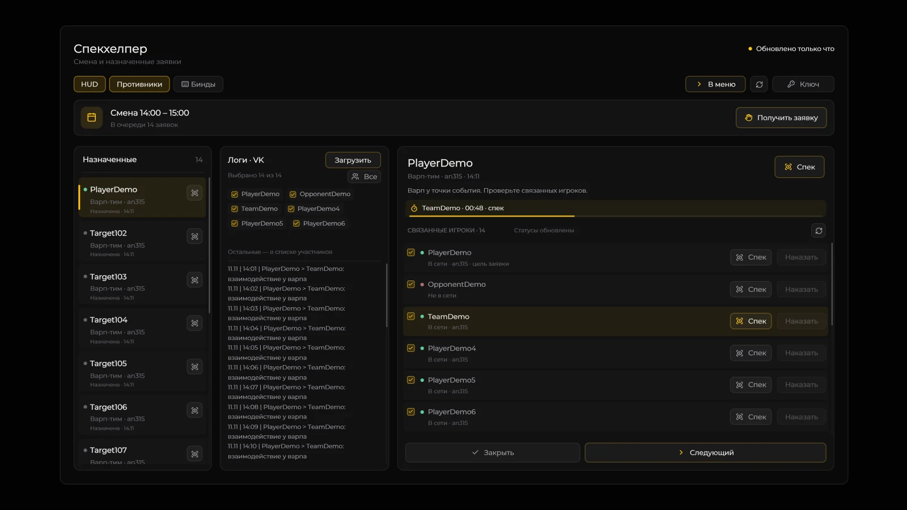
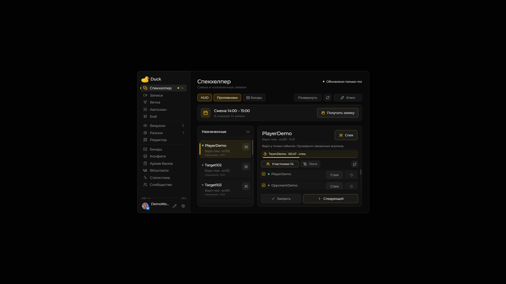
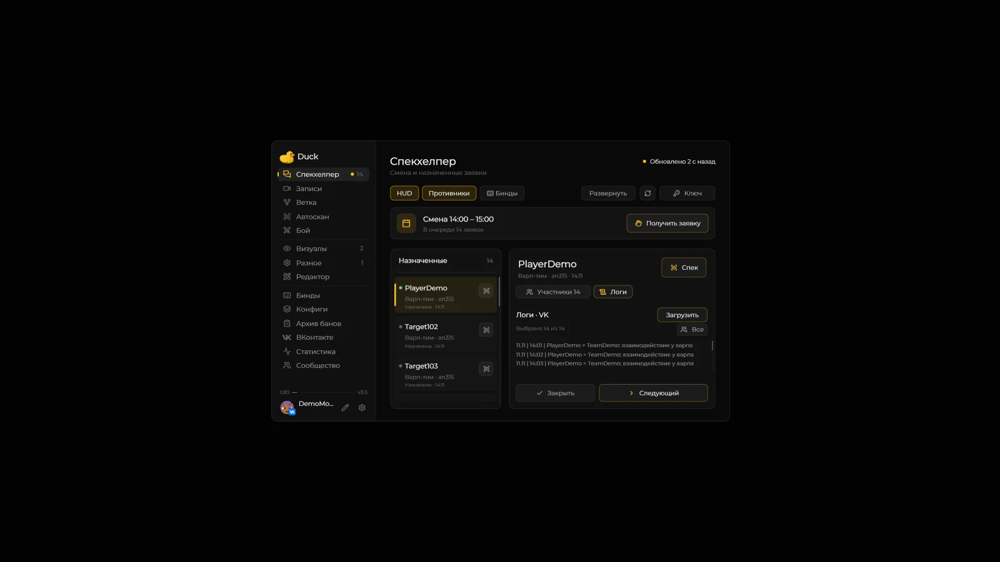

# Спекхелпер

Спекхелпер показывает подтверждённую смену и назначенные вам заявки из «Модерация2» tink.work. В **3.5** доступен развёрнутый рабочий экран с очередью, логами и участниками.

1. Откройте **Right Shift → Спекхелпер → Ключ**, вставьте ключ из расширения tink.work и нажмите **«Сохранить»**.
2. Подтвердите свою смену на сайте. После обновления в моде появятся смена и личная очередь.
3. Выберите назначенную заявку слева или нажмите **«Получить заявку»**. Выбор строки проверяет присутствие игроков; сам по себе он не запускает спек.
4. Нажмите большую **«Спек»** в заголовке для основной цели или **«Спек»** рядом с участником. Значок спека на карточке очереди также сразу запускает наблюдение за основной целью.
5. После подтверждения перехода сайтом запускается таймер с ориентирами **30 секунд** и **2 минуты**. Наблюдаемый игрок выделяется акцентом темы.
6. Нажмите **«Закрыть»** или **«Следующий»**. «Следующий» сначала закрывает текущую заявку и только после подтверждения получает следующую. Если закрытие не удалось, новая заявка не запрашивается. Спек следующего игрока запускается отдельной кнопкой.

## Развёрнутый экран

Кнопка **«Развернуть»** открывает три колонки: назначенные заявки слева, логи посередине и выбранная заявка с участниками справа. Очередь, участники и логи прокручиваются независимо колесом и ползунками. Можно нажать на дорожку ползунка или перетаскивать его за пределами списка. Скрытые части строк не перехватывают нажатия.

**Esc** или **«В меню»** возвращает обычное меню с прежней выбранной заявкой, выбором игроков для логов и положением списков.

В обычном меню справа находятся вкладки **«Участники»** и **«Логи»**. Кнопки **«Закрыть»** и **«Следующий»** закреплены под содержимым.

## Присутствие и наказания

Участники имеют индикатор: зелёный — сайт подтвердил присутствие, красный — игрок не в сети, серый — актуальных данных нет. В развёрнутом виде также показаны подпись статуса и сервер, если он получен от сайта. В карточках заявок показано время создания, когда оно доступно.

При выборе заявки присутствие проверяется автоматически. С включённым автообновлением проверка выбранной заявки повторяется примерно раз в **30 секунд**. Значок обновления над участниками запускает её вручную. Данные старше минуты не выдаются за актуальный статус. Если сайт отвечает, что игрок не в сети, мод показывает эту причину и не запускает таймер.

**«Наказать»** рядом с ником открывает штатное [меню цели](target-menu-ui.md) сразу на выборе наказания. В обычном меню это кнопка со щитом. Она доступна при подключении к игре; нажатие само по себе не выдаёт бан.

## Логи выбранных игроков

Флажки у участников и ников в колонке логов задают состав запроса. При переходе к другой заявке выбраны все её участники. **«Все»** восстанавливает этот выбор.

Для **«Загрузить»** нужны минимум **два ника**, вход во [ВКонтакте](vk-screen.md) и готовый диалог с FunTime Administration. Запрос отправляется через существующую функцию логов VK. Полученный ответ отображается в своей колонке или вкладке и прокручивается. При смене набора ников логи другого набора не подставляются.

Загрузка логов, выдача наказания и завершение смены через API сайта в предоставленной записи не подтверждены. Логи работают через VK, наказания — через меню цели. Автоматическое завершение смены не добавлено.

## Подключение, HUD и запись

**Автообновление**, **HUD** и **Противники** включены по умолчанию. Автообновление проверяет смену и личную очередь раз в **5 секунд**. Значок обновления в верхней панели работает и при включённом автообновлении. **Противники** управляют дополнительными участниками игрового HUD. Кнопки HUD работают в открытом чате.

Ключ и переключатель автообновления находятся под кнопкой **«Ключ»**. После сохранения панель сворачивается. Мод обменивает ключ на токен доступа; открытый браузер для последующих запросов не требуется.

В [«Биндах»](keybindings.md) можно включить подтверждение второго нажатия для бинда **«Закрыть и далее»**. По умолчанию оно выключено. На кнопке «Следующий» в окне это подтверждение не применяется.

**Автозапись смены** включена по умолчанию. Она стартует при подтверждённой смене на FunTime и продолжается между заявками. Для остановки нажмите **«Закончить запись»** в [«Записях»](records-screen.md).

Снимки сделаны в отдельном клиенте с демонстрационными данными. Сетевые действия проверены локальным HTTP-стендом без рабочих ключей; живое подключение требуется подтвердить на смене.
