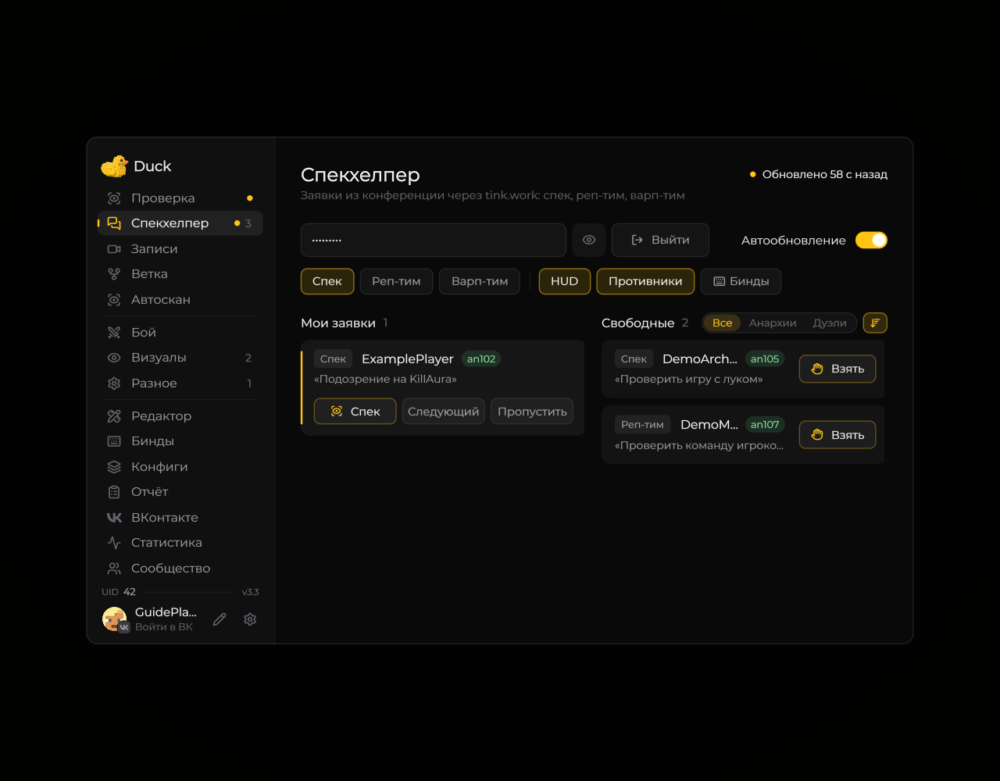

# Спекхелпер

Спекхелпер показывает свои и свободные заявки tink.work. Подключение настраивается ключом из расширения сервиса.

<figure><figcaption>
Свои и свободные заявки спекхелпера · Duck Util 3.3. Демонстрационные данные.
</figcaption></figure>

Доступны фильтры по типу заявок и серверам, автообновление и кнопки действий в строках. При включённом HUD заявки видны поверх игры.

<figure><figcaption>
Заявки и противники в игровом HUD · Duck Util 3.3. Демонстрационные данные.
</figcaption></figure>

[Клавиши спекхелпера](keybindings.md)
