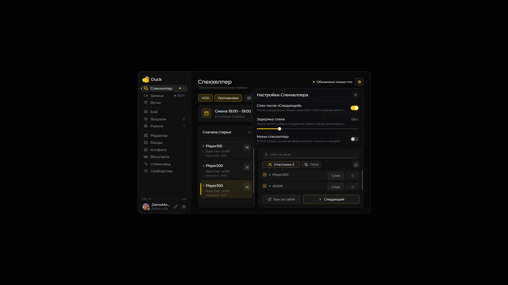
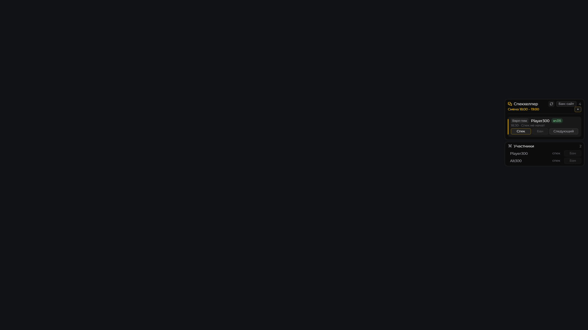

# Спекхелпер

Спекхелпер показывает подтверждённую смену и назначенные вам заявки из «Модерация2» tink.work. В **4.0** доступен развёрнутый рабочий экран с очередью, логами и участниками.

1. Откройте **Right Shift → Спекхелпер → Ключ**, вставьте ключ из расширения tink.work и нажмите **«Сохранить»**.
2. Подтвердите свою смену на сайте. После обновления в моде появятся смена и личная очередь.
3. Выберите назначенную заявку слева или нажмите **«Получить заявку»**. Выбор строки проверяет присутствие игроков; сам по себе он не запускает спек.
4. Нажмите большую **«Спек»** в заголовке для основной цели или **«Спек»** рядом с участником. Значок спека на карточке очереди также сразу запускает наблюдение за основной целью.
5. После подтверждения перехода сайтом запускается таймер с ориентирами **30 секунд** и **2 минуты**. Наблюдаемый игрок выделяется акцентом темы.
6. Нажмите **«Следующий»**: после подтверждения закрытия мод выберет самую старую оставшуюся назначенную заявку. Если очередь пуста, новая запрашивается только во время активной смены. При ошибке закрытия текущая заявка остаётся выбранной. По умолчанию через **0,6 секунды** мод автоматически нажимает «Спек» для основной цели выбранной следующей заявки. Это работает и для бинда «Следующий».

## Шестерёнка Спекхелпера · 4.1

В **Right Shift → Спекхелпер → шестерёнка** доступны:

* **Спек после «Следующий»** — включён по умолчанию. Переход запускается только после успешного закрытия и выбора назначенной следующей заявки. При ошибке или пустой очереди спек не отправляется.
* **Задержка спека** — **0,2–2 секунды**, шаг **0,1**, по умолчанию **0,6**. Отсчитывается после выбора следующей заявки.
* **Мини-спекхелпер** — выключен по умолчанию. Показывает в HUD только одну активную выбранную заявку вместо списка из четырёх. Счётчик в шапке сохраняет общее число заявок.

Ручной выбор другой заявки, запуск спека другого участника, смена ключа или выключение автоспека отменяют ожидающий переход. HUD **«Противники» / «Участники»** показывает основную цель и связанных игроков именно активной заявки и обновляется при её смене.

## Очередь и конец смены

В GUI и HUD заявки упорядочены **от старых к новым по времени создания**. Например, после закрытия заявки 18:40 мод выберет оставшуюся 18:30 перед 18:50. Выбранная заявка появляется в видимой части очереди. Отдельной кнопки «Закрыть» больше нет; завершение и переход объединены в **«Следующий»**.

В минуту конца смены Спекхелпер **сохраняет незавершённые назначенные заявки** и показывает **«Дорабатываем заявки смены»**. Спек, бан, логи и «Следующий» остаются доступны. Получение новых заявок отключается. Работа с остатком продолжается, даже если сайт больше не возвращает прошедший слот или выключает режим смены. Общая публичная очередь при этом не подмешивается к личной.

После закрытия последней заявки режим доработки заканчивается. Непрерывная запись останавливается вручную. Временная ошибка сети сохраняет очередь и открытые клипы; действия доступны после восстановления связи.

## Личные напоминания о сменах

### Короткая инструкция

1. Откройте **Right Shift → Спекхелпер → Ключ**, вставьте свой ключ из расширения tink.work и нажмите **«Сохранить»**. Расписание и напоминания подключатся автоматически.
2. Если VK ещё не привязан, нажмите **«Копировать команду»**, откройте диалог кнопкой **«Открыть бота»** и отправьте **/привязать КОД** нашему боту Duck в личные сообщения. Разрешите сообщения сообщества. Код действует **5 минут**; при уже привязанном VK этот шаг пропускается.
3. Готово: бот напомнит за **10 минут до смены**, даже при закрытой игре. Состояние и выключение — **Спекхелпер → Смены**. Для ключа, сохранённого до обновления, нажмите там **«Повторить подключение»**.

Нужны обновлённая серверная часть Duck с настроенным шифрованием и VK-ботом, а также разрешённые сообщения сообщества. После привязки отдельно включать переключатель не нужно: доставка начнётся после успешной проверки календаря.

### Управление и работа сервера

Ключ tink.work передаётся серверу Duck при сохранении и хранится зашифрованным. Ранее сохранённые локальные ключи сами на сервер не загружаются: для такого ключа откройте **Спекхелпер → Смены → Повторить подключение**. Повторное сохранение того же ключа сохраняет идентификаторы уже отправленных напоминаний.

Сообщения приходят каждому пользователю только в его подтверждённый личный диалог. Серверу не нужен личный VK-токен из мода. Логи и апелляции FunTime Administration используют отдельное подключение.

**Спекхелпер → Смены** показывает состояние, ближайшую смену и переключатель **«Напоминать за 10 минут»** для ручного выключения. **«Удалить ключ с сервера»** удаляет зашифрованный ключ и выключает напоминания; **«Отвязать VK»** прекращает доставку в этот диалог. Новое сохранение ключа снова включает напоминания и сохраняет существующую привязку VK. Если выключить их вручную во время ожидания кода, последующая привязка сохраняет выключенное состояние. При отказе ключа сайта доставка приостанавливается; при запрете сообщений VK разрешите их и отправьте **/напоминания вкл**.

Напоминания работают **при закрытом Minecraft**, пока доступны сервер Duck, MongoDB, tink.work и VK. Сервер проверяет будущие включённые слоты, в том числе неподтверждённые. Время показывается по **Москве**; перед живым использованием администратору нужно сверить часовой пояс ответов tink.work.

Обычное обновление расписания — раз в **5 минут**, перед ближайшей сменой — примерно раз в **минуту**. Очередь проверяется раз в **15 секунд**. Перенос и отмена слота обновляют ожидающее сообщение после синхронизации. Задания сохраняются между перезапусками; при повторе отправки используется прежний идентификатор сообщения. Фактическое время доставки зависит от сети и VK. Напоминание об уже начавшейся смене не отправляется задним числом.

Команды в личном диалоге: **/смены**, **/следующая**, **/напоминания вкл**, **/напоминания выкл**, **/отвязать**. Команды расписания показывают последний полученный календарь.

Сервер напоминаний читает расписание. Он не подтверждает смену, не берёт заявки и не выдаёт наказания от вашего имени.

## Развёрнутый экран

Кнопка **«Развернуть»** открывает три колонки: назначенные заявки слева, логи посередине и выбранная заявка с участниками справа. Очередь, участники и логи прокручиваются независимо колесом и ползунками. Можно нажать на дорожку ползунка или перетаскивать его за пределами списка. Скрытые части строк не перехватывают нажатия.

**Esc** или **«В меню»** возвращает обычное меню с прежней выбранной заявкой, выбором игроков для логов и положением списков.

В обычном меню справа находятся вкладки **«Участники»** и **«Логи»**. Единственная кнопка **«Следующий»** закреплена под содержимым.

## Присутствие и наказания

Участники имеют индикатор: зелёный — сайт подтвердил присутствие, красный — игрок не в сети, серый — актуальных данных нет. В развёрнутом виде также показаны подпись статуса и сервер, если он получен от сайта. В карточках заявок показано время создания, когда оно доступно.

При выборе заявки присутствие проверяется автоматически. С включённым автообновлением проверка выбранной заявки повторяется примерно раз в **30 секунд**. Значок обновления над участниками запускает её вручную. Данные старше минуты не выдаются за актуальный статус. Если сайт отвечает, что игрок не в сети, мод показывает эту причину и не запускает таймер.

**«Наказать»** рядом с ником открывает обычное [меню цели](target-menu-ui.md) на выборе наказания. В обычном меню Спекхелпера это кнопка со щитом, в HUD — **«Бан»** в карточке и у участника. Выбранный вид меню цели сохраняется: окно, колесо или компакт. Наказание использует прежние игровые команды, отчёт и **Ban Effect**. Для этого нужно находиться в игре; подключение tink.work не заменяет команду бана.

Для бана именно через сайт используйте отдельную кнопку **«Бан на сайте»** под выбранной заявкой либо **«Бан: сайт»** в шапке HUD. Откроется подтверждение tink.work. В строке **«Игрок»** стрелками выберите основную цель или любого связанного участника. Выбор игрока сам по себе ничего не отправляет. Нужны ключ tink.work и актуальная назначенная заявка; открытый браузер не требуется.

Окно загружает причину, срок по умолчанию и доступные варианты с сайта для типа заявки. Поля можно изменить; **«авто»** оставляет подбор срока сайту по истории нарушений. Проверьте ник, причину и срок и нажмите **«Забанить Ник»**. Пока запрос отправляется, повторное нажатие блокируется. При ошибке окно остаётся открытым и показывает причину; автоматического повтора бана нет.

После успешного ответа бан отмечается в текущей записи. Сам бан заявку не закрывает: для полного клипа завершите разбор кнопкой **«Следующий»**. Обычная кнопка наказания продолжает использовать команды игрового сервера; запрос tink.work отправляется только из отдельного окна сайта.

## Логи выбранных игроков

Флажки у участников и ников в колонке логов задают состав запроса. При переходе к другой заявке выбраны все её участники. **«Все»** восстанавливает этот выбор.

Для **«Загрузить»** нужны минимум **два ника**, вход во [ВКонтакте](vk-screen.md) и готовый диалог с FunTime Administration. Запрос отправляется через существующую функцию логов VK. Полученный ответ отображается в своей колонке или вкладке и прокручивается. При смене набора ников логи другого набора не подставляются.

Логи загружаются через VK. Контракт бана сверён с интерфейсом tink.work; запрос, подтверждение и ошибки проверены локальным HTTP-стендом без выдачи живых наказаний. Автоматическое завершение смены на сайте не добавлено.

## Полные клипы заявок Спекхелпера

В новых записях 4.0 начало заявки отмечается при **первом подтверждённом переходе в спек** по её основной цели или любому участнику. Конец — когда мод получает подтверждение закрытия заявки либо замечает её исчезновение из личной очереди.

**Клип каждого участника включает весь этот разбор заявки.** Переключение между игроками и сам бан не обрезают его до отдельного спека или пяти секунд после бана. Кнопка **«Заявка идёт»** показывает, что окончательный клип ещё не готов; скачивание и апелляция доступны после закрытия.

Успешный бан отдельной кнопкой **«Бан на сайте»** отмечается в записи по ответу tink.work. Обычные наказания из меню цели сохраняют прежнюю разметку через команды и отметки наказаний. Подтверждение **«\[♨] Ник забанен»** в игровом чате также учитывается, например после самостоятельного действия в браузере. Сам клик в браузере мод не получает. Если отметка бана не пришла, полный клип участника можно найти по нику на странице **«Записи»**.

**«Следующий» завершает клип только своей заявки.** Другие открытые заявки продолжают записываться. Доработка после конца смены не обрезает разбор.

Это разметка фактически записанного видео: при остановке записи или выходе доступен записанный фрагмент. Старые записи задним числом не получают границы заявки. Обычные ручные спеки и архивные ревизии сохраняют прежние правила; настройка **«До заявки в клипе»** не добавляет запас к новым полным клипам заявок.

## Подключение, HUD и запись

**Автообновление**, **HUD** и **Противники** включены по умолчанию. Автообновление проверяет смену и личную очередь раз в **5 секунд**. Значок обновления в верхней панели работает и при включённом автообновлении. **Противники** управляют дополнительными участниками игрового HUD. Кнопки HUD работают в открытом чате.

Ключ и переключатель автообновления находятся под кнопкой **«Ключ»**. После сохранения панель сворачивается. Мод обменивает ключ на токен доступа; открытый браузер для последующих запросов не требуется.

В **4.1** для большой кнопки «Спек» назначьте клавишу **Right Shift → Бинды → Спекхелпер → Спек заявки**. По умолчанию клавиша не задана. Бинд выбирает основную цель активной заявки, как большая кнопка в GUI; он работает в игре без открытого чата или меню.

В [«Биндах»](keybindings.md) можно включить подтверждение второго нажатия для бинда **«Следующий»**. По умолчанию оно выключено. На кнопке «Следующий» в окне это подтверждение не применяется.

**Автозапись смены** включена по умолчанию. По умолчанию она стартует при подтверждённой смене на FunTime и продолжается между заявками. В **Записи → шестерёнка → Начинать запись** можно выбрать **«С первого спека»**; тогда мод ждёт первого успешного спека заявки или команды `/spec Ник` в подтверждённой смене. Режим **«С подтверждения»** сохраняет прежнее поведение. Для остановки нажмите **«Закончить запись»** в [«Записях»](records-screen.md).

Снимки сделаны в отдельном клиенте с демонстрационными данными. Сетевые действия проверены локальным HTTP-стендом без рабочих ключей; живое подключение требуется подтвердить на смене.
