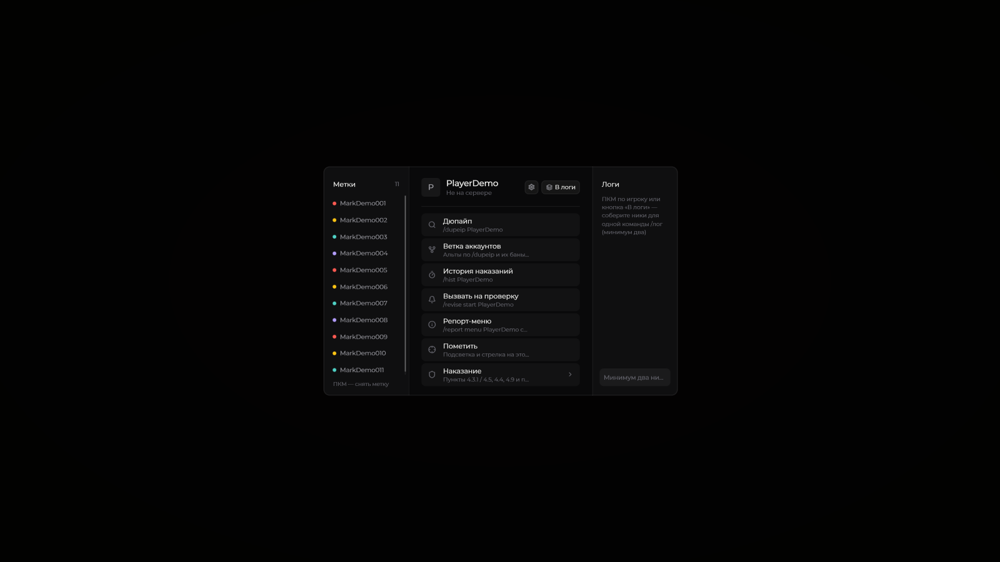
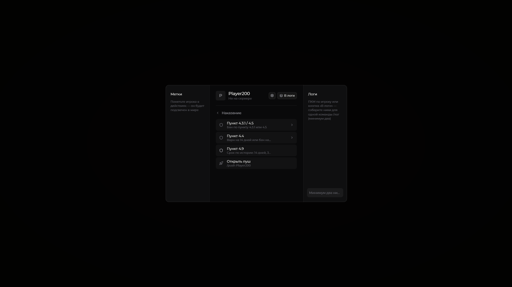

# Меню цели

Нажмите **V** в игровом мире и выберите игрока. В меню собраны быстрые действия: история, дюпайп, спек, репорты и наказания. Доступность действий зависит от прав и команд игрового сервера.



<figure><figcaption>
Меню цели — обычное окно · Duck Util 4.0. Демонстрационные данные: 11 меток.
</figcaption></figure>



<figure><figcaption>
Меню цели — колесо действий · Duck Util 3.3. Демонстрационные данные.
</figcaption></figure>



<figure><figcaption>
Меню цели — компактный вид · Duck Util 3.3. Демонстрационные данные.
</figcaption></figure>



Вид выбирается в [Target Menu](../moduli/target-menu.md). Шестерёнка позволяет настроить порядок действий. Если включено «Подтверждать удержанием», удерживайте кнопку наказания до заполнения полосы; по умолчанию удержание выключено.

## Обычные наказания

Кнопка **«Наказание»** в меню цели, **«Наказать»** у участника Спекхелпера и **«Бан»** в его HUD открывают привычный выбор пунктов правил. Они используют команды игрового сервера и выбранный **Ban Effect**. В **4.1** пункт **4.9** запускается сразу без выбора PvP/PvE. Мод сначала проверяет историю и выбирает прежний срок: 14 дней, 31 день или навсегда. Наказание отмечается в видеозаписи; окон выбора категории отчёта больше нет. Подключение tink.work не меняет этот путь.

Бан через tink.work доступен отдельно в [Спекхелпере](spec-helper.md): **«Бан на сайте»** под заявкой или **«Бан: сайт»** в шапке HUD. В окне сайта можно выбрать участника заявки. В обычном меню цели действие сайта не подменяет команду бана.

## Вызов на проверку

Кнопка **«Вызвать на проверку»** доступна во всех трёх видах меню цели при включённом [Old (revise)](../moduli/interface.md). Она отправляет `/revise start НикИгрока`. Дальше сессия видна на [странице «Проверка»](check-screen.md). На Бедрок-анархии вызов недоступен.

## Метки и прокрутка · 4.0

Для бокового списка меток выберите **Right Shift → Бой → Target Menu → Вид → Окно**, затем откройте меню клавишей **V**. Добавить игрока можно действием **«Пометить»**.

В **4.0** исправлена обрезка списка после десятой записи. Счётчик в шапке показывает общее число меток, а до любой записи можно добраться без удаления других игроков:

* Наведите мышь на список **«Метки»** слева и вращайте колесо.
* Либо удерживайте **ЛКМ** на ползунке справа от списка и тяните его. Захват сохраняется при движении за рамку; отпускание кнопки завершает прокрутку.
* Нажатие на свободную часть дорожки переносит список к выбранному месту.

**ЛКМ по нику** выбирает игрока и открывает его действия. **ПКМ по нику** снимает только эту метку. Прокрутка сама метки не удаляет. Скрытые части строк над списком и под ним не перехватывают нажатия.

После удаления записей положение прокрутки подстраивается под оставшийся список. Если все строки помещаются, ползунок скрыт. Дополнительный переключатель для прокрутки не нужен. Метки, как и прежде, хранятся до выхода с сервера.

<figure><figcaption>
Все метки доступны · Duck Util 4.0. Демонстрационные данные: 51 запись.
</figcaption></figure>

## Визуальные сцены

[Ban Effect](../moduli/ban-effect.md) запускается при наказании. Время отправки наказания зависит от выбранного эффекта.

В [Последней дуэли](../moduli/last-duel.md) бан выполняется сразу, затем после закрытия меню появляется отдельная камера с мечом. В **3.4** этот запуск исправлен для окна, колеса и компактного вида. Окно предпросмотра дуэли управление не захватывает.

[Модерация и баны](../vozmozhnosti/ban-system.md) · [Эффекты бана](../moduli/ban-effect.md)
