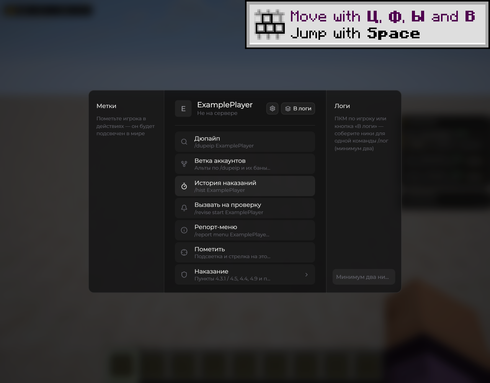

# Меню цели

Нажмите **V** в игровом мире и выберите игрока. В меню собраны быстрые действия: история, дюпайп, спек, вызов на проверку, репорты и наказания. Доступность действий зависит от прав и команд игрового сервера.



<figure><figcaption>
Меню цели — обычное окно · Duck Util 3.3. Демонстрационные данные.
</figcaption></figure>


<figure><figcaption>
Меню цели — колесо действий · Duck Util 3.3. Демонстрационные данные.
</figcaption></figure>


<figure><figcaption>
Меню цели — компактный вид · Duck Util 3.3. Демонстрационные данные.
</figcaption></figure>



Вид выбирается в [Target Menu](../moduli/target-menu.md). Шестерёнка позволяет настроить порядок действий. Для выдачи наказания удерживайте кнопку, пока не заполнится полоса.

[Как учитываются результаты проверки](../vozmozhnosti/ban-system.md) · [Эффекты бана](../moduli/ban-effect.md)
