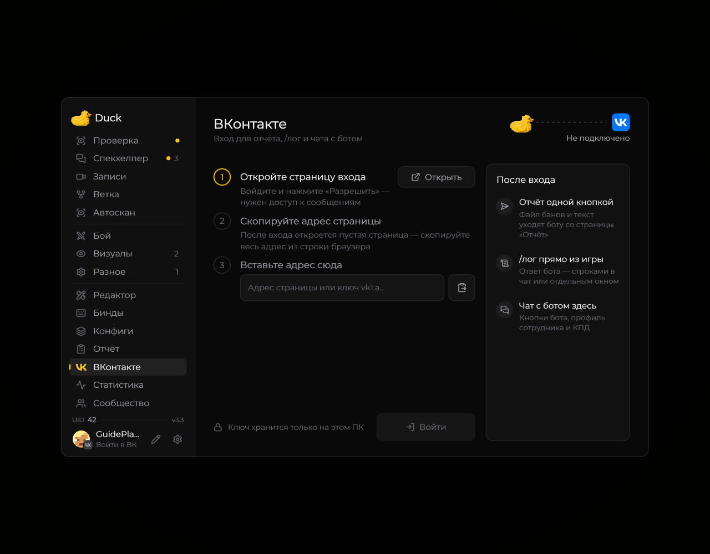

# ВКонтакте

На странице «ВКонтакте» находятся вход и существующие инструменты интеграции с ВК. Экспериментальный отдельный чат-HUD в версии 3.3 удалён.

<figure><figcaption>
Страница входа в ВКонтакте · Duck Util 3.3.
</figcaption></figure>

Для подключения следуйте инструкции на самой странице. После входа доступны поддерживаемые модом функции. На скриншоте вход не выполнен; действующих ключей и токенов нет.

В 3.5 дневные отчёты больше не отправляются из мода.

## Апелляции к клипам

После подключения диалог с FunTime Administration используется и для ответов на апелляции. Для вложения нужен доступ VK к видео. Если прежний вход не даёт этого доступа, войдите во ВКонтакте снова из меню Duck Util.

Запись отправляется приватным видеовложением с текстом в одном сообщении. Как открыть плеер и написать ответ, описано на странице [«Записи»](records-screen.md).
