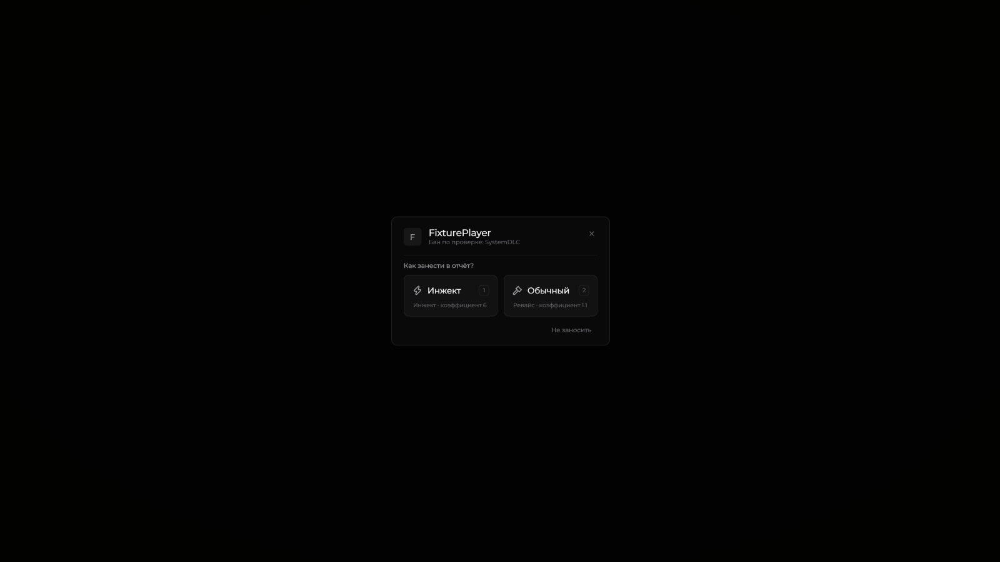

# Модерация и баны

Duck Util помогает работать с целью, выдавать наказания и вести отчёт. Команды и права предоставляет игровой сервер; мод выполняет действия от вашего имени.

## Меню цели и эффекты

В игровом мире нажмите **V**, чтобы открыть действия с целью. Включённый [Ban Effect](../moduli/ban-effect.md) показывает выбранную сцену при наказании из этого меню. Эффект видите только вы.

## Итоги проверки

При включённом учёте результатов команда `/revise finish ...` добавляет результат в отчёт. Повторное сообщение о том же бане в чате не создаёт вторую запись.

**SystemDLC без хранения** открывает то же окно выбора категории, что и **Прочее (навсегда)**:

- **Инжект** — записать как `inject`.
- **Обычный** — записать обычный результат проверки (`revise`; для завершения фриза без проверки — `freeze`).


**Хранение учитывается отдельно.** Результат **SystemDLC(Хранение)**, включая варианты регистра и пробелы, записывается как **`revise`** без окна выбора. Категории остальных клиентов не меняются.


Окно выбора SystemDLC в версии 3.3

<figure><figcaption>
Нажмите на изображение, чтобы рассмотреть окно. Игрок на снимке тестовый.
</figcaption></figure>

Окно выбирает категорию уже выданного наказания; повторно банить игрока оно не будет. Вопросы ждут в очереди, пока открыты другие окна. Можно выбрать **Не заносить**.

## Чат и архив

Мод распознаёт поддерживаемые собственные команды и сообщения сервера о банах. Для пункта **4.9** предлагается выбор **PVP/PVE**. Доступность учёта зависит от настроек и формата сообщений сервера.

Рабочие отчёты находятся в **Duck Util/Баны**. Резервный лог сохраняет сведения о наказаниях отдельно от основного отчёта.
