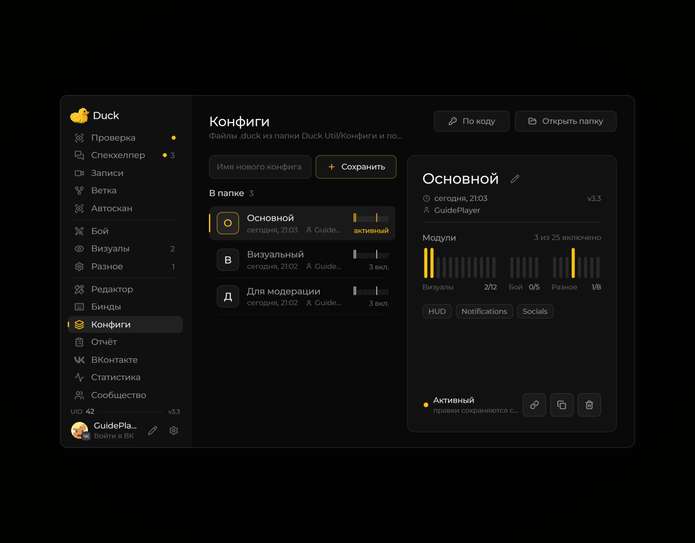
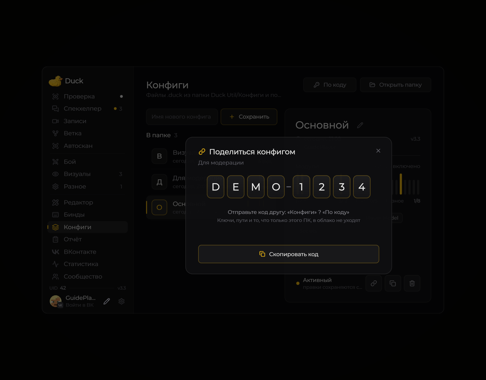
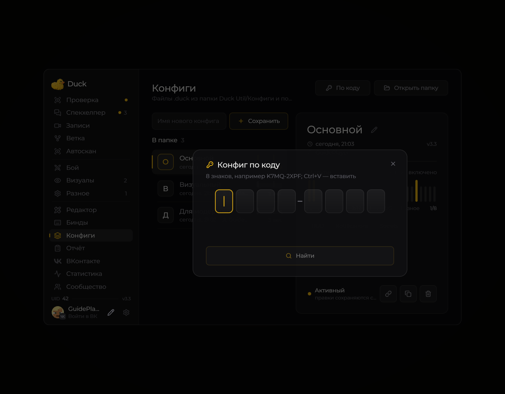

# Конфиги и обмен по коду

На странице **Конфиги** хранятся файлы `.duck` из **Duck Util/Конфиги**. Сохраните настройки под своим именем, выберите файл и нажмите **Поделиться**.

<!-- screenshots-3.3 -->
<figure><figcaption>
Конфиги: список, активный профиль и состав · Duck Util 3.3. Демонстрационные данные.
</figcaption></figure>

Как выглядят обмен и загрузка по коду

<figure><figcaption>
Публикация конфига: демонстрационный код DEMO-1234 · Duck Util 3.3. Демонстрационные данные.
</figcaption></figure>

<figure><figcaption>
Окно ввода кода конфига · Duck Util 3.3.
</figcaption></figure>

<!-- /screenshots-3.3 -->

Мод загрузит общий конфиг в облако и покажет код из **8 знаков**. Другой пользователь откроет **Конфиги → По коду**, посмотрит сведения о файле и сохранит его в свою папку. Для облачных операций нужна действующая лицензия.

Ключи лицензии, локальные пути и настройки только этого компьютера в общий конфиг не включаются.

## Переключатели после обновления

Начиная с **3.4**, конфиг сохраняет выбранную включённость модулей независимо от ожидания проверки лицензии. Временная недоступность функции не должна записывать её выключенной; намеренно отключённые модули сохраняют своё состояние.

Если старый клиент уже перезаписал конфиг с выключенными функциями, обновление само не узнает прежний выбор. Загрузите сохранившийся конфиг с нужными переключателями или включите нужные модули вручную. Настройки удалённого Duck Pet пропускаются и исчезают при сохранении; остальные параметры сохраняются.

## Размер и ошибка 413

Лимит облачного конфига — **400 КБ в UTF-8**. Клиент 3.3 отправляет JSON без лишних отступов, сохраняя значения настроек.

**HTTP 413** означает, что сервер отклонил размер запроса. Если ошибку получает небольшой обычный конфиг, администратору нужно установить исправление сервера 3.3: запросы конфигов должны использовать собственный лимит тела, а не общий лимит лицензирования 4 КБ. Одного обновления JAR для старого сервера недостаточно.

Ошибки публикации показываются с причиной в несколько строк. При сетевом сбое следуйте подсказке; при превышении размера уменьшите конфиг.
