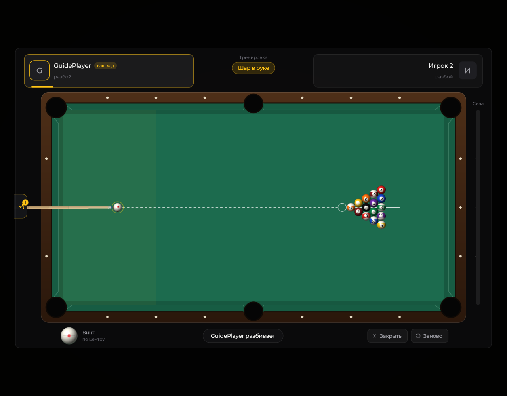
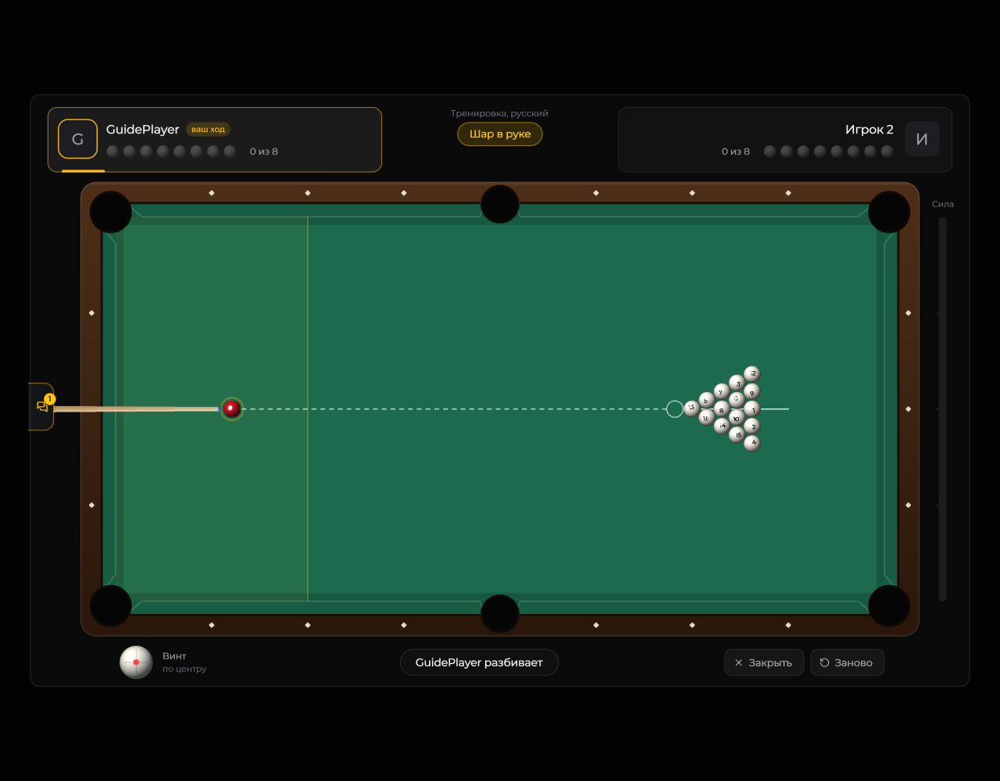
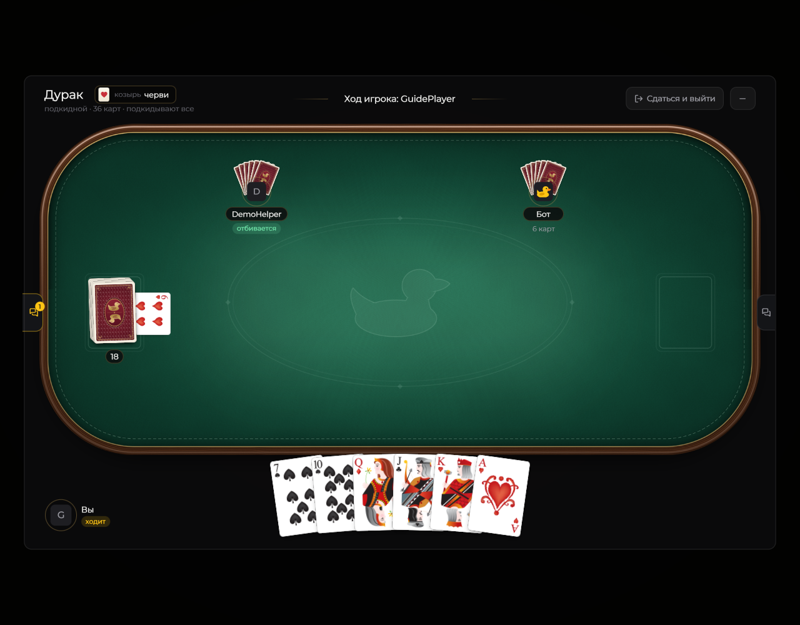
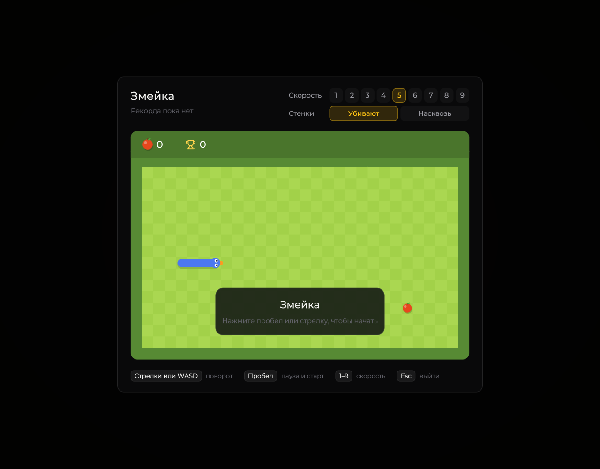

# Встроенные игры

Откройте **Right Shift → Сообщество**. Здесь можно выбрать игру и пригласить другого пользователя мода. Бильярд также позволяет тренироваться одному. Снимки ниже сделаны с демонстрационными участниками.



В тренировке оба места принадлежат вам. Доступны пул и русский бильярд.

<figure><figcaption>
Тренировка в пуле · Duck Util 3.3.
</figcaption></figure>

Русский бильярд

<figure><figcaption>
Тренировка в русском бильярде · Duck Util 3.3.
</figcaption></figure>



Создайте стол или присоединитесь к открытому. Настройки стола определяют тип игры, колоду и таймер хода. Для партии и ботов используется сервер мода.

<figure><figcaption>
Стол дурака: козырь, соперники и карты в руке · Duck Util 3.3. Демонстрационные данные.
</figcaption></figure>


Выберите скорость и режим стенок. Подсказки управления находятся под игровым полем.

<figure><figcaption>
Змейка внутри Duck Util · Duck Util 3.3.
</figcaption></figure>



[Экран сообщества](../nastroika/social-view.md)
