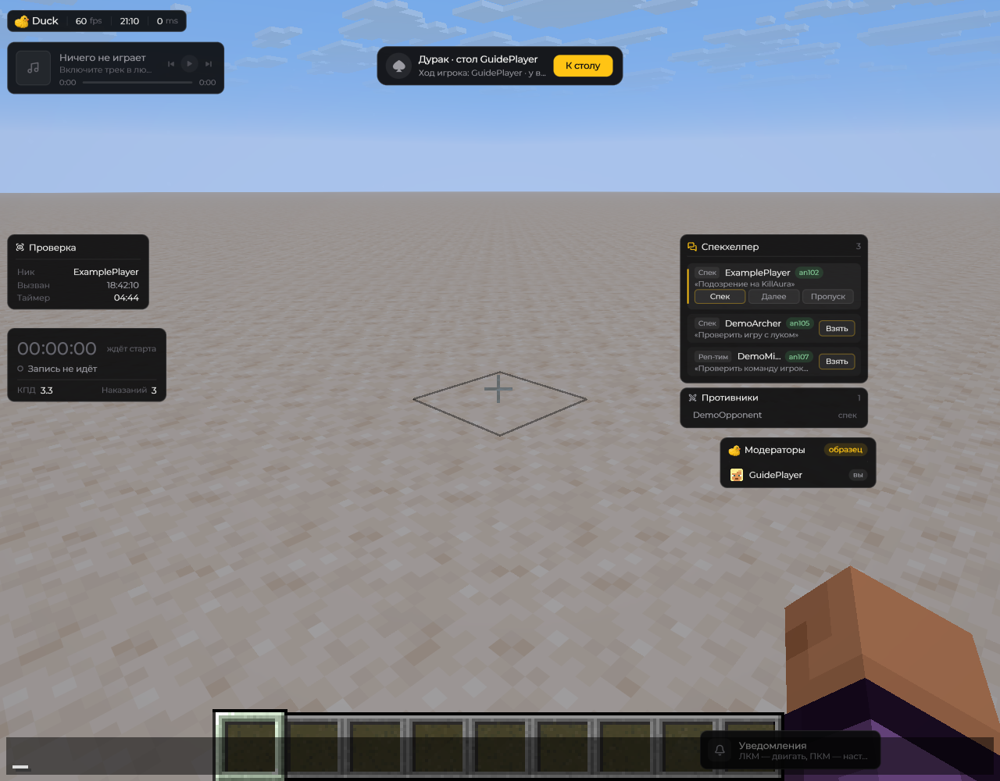
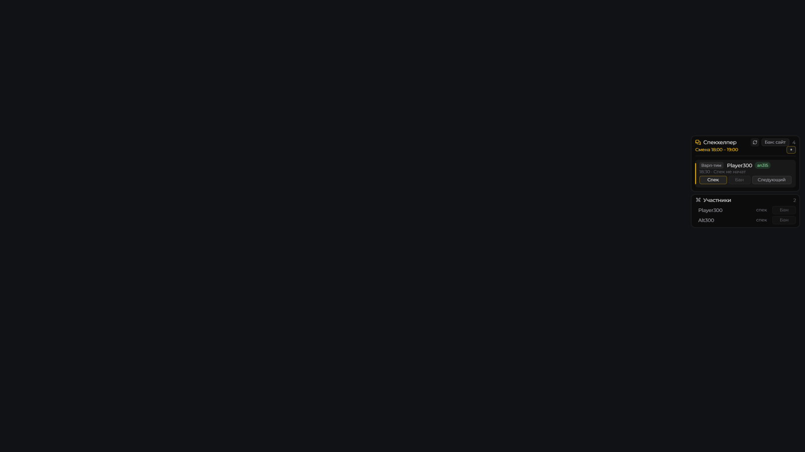

# HUD и оформление

HUD — это элементы Duck Util, которые отображаются поверх игры. Состав зависит от версии и выбранных модулей: например, на экран можно вывести координаты, сведения о цели или FPS.

<figure><figcaption>
HUD: проверка, WorkHud, спекхелпер и панели · Duck Util 3.3. Демонстрационные данные.
</figcaption></figure>

Чтобы настроить HUD, откройте меню клавишей **Right Shift**, выберите нужный раздел и воспользуйтесь [редактором HUD](../nastroika/hud-editor.md), чтобы изменить расположение элементов.

## Отдельный рабочий чат

**Визуалы → HUD → Рабочий чат** собирает видимые `/dupeip`, `/hist`, переписку активной проверки, репорты, логи и рабочие статусы в отдельном окне. Тихие технические ответы «Ветки» остаются скрытыми.

Окно можно двигать и растягивать в открытом чате. Поддерживаются прокрутка, перенос строк, исходные ссылки и категории. Префикс переписки проверки только здесь тёмно-красный жирный; обычный чат сохраняет серверное оформление.

[Подробная настройка рабочего чата](../moduli/work-chat.md)

## Спекхелпер смены

HUD показывает назначенные заявки подтверждённой смены. **Спекхелпер → шестерёнка → Мини-спекхелпер** оставляет одну активную заявку вместо четырёх; по умолчанию выключен. «Противники» отображает основную цель и связанных игроков активной заявки.

