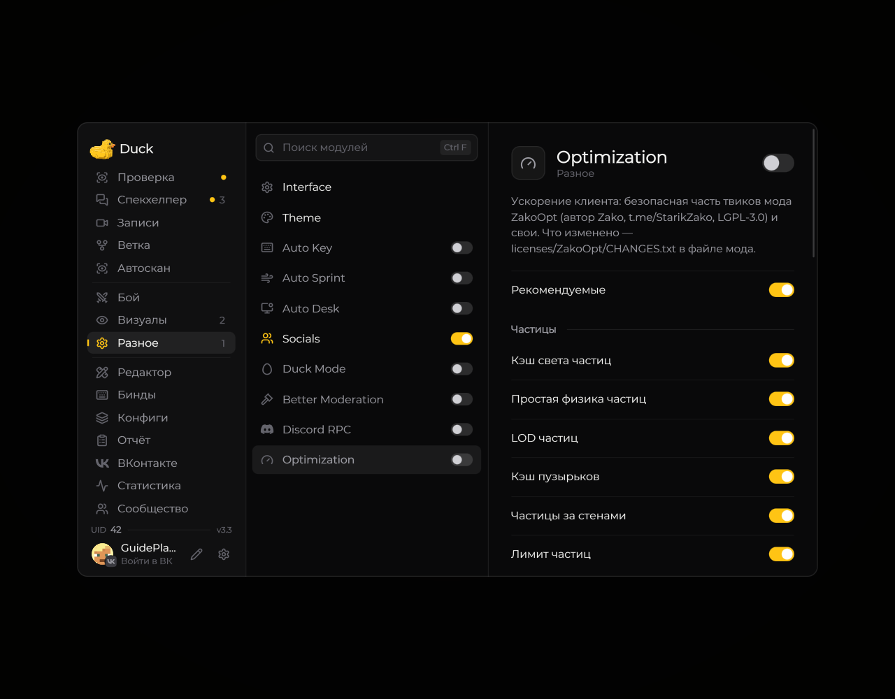

# Оптимизация

Модуль **Optimization** содержит параметры, которые могут влиять на производительность клиента.

<!-- screenshots-3.3 -->
<figure><figcaption>
Настройки оптимизации клиента · Duck Util 3.3.
</figcaption></figure>
<!-- /screenshots-3.3 -->

Откройте модуль из меню Duck Util и меняйте доступные настройки по одной. Результат зависит от компьютера, мира и графических параметров Minecraft. Если заметили артефакты или ухудшение производительности, отключите последнее изменение.
