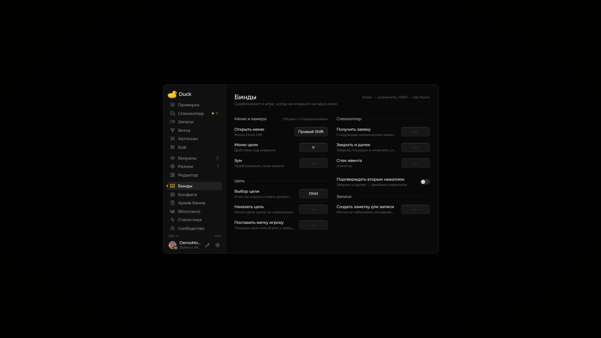

# Запись экрана

Duck Util содержит инструменты для сохранения игровых событий. Доступность записи, автоматических клипов и интеграции с OBS зависит от версии мода и ваших настроек.

<figure><figcaption>
Записи: управление записью и настройки · Duck Util 3.3. Демонстрационные данные.
</figcaption></figure>

Откройте раздел **Records** в меню Duck Util, чтобы посмотреть доступные функции и записи. Перед длительной записью проверьте свободное место на диске и параметры сохранения.

## Запись во время смены

При включённой по умолчанию **«Авто-записи смены»** видео начинается на FunTime после того, как мод увидит подтверждённую смену. Запись продолжается между заявками. По окончании нажмите **«Закончить запись»**. По умолчанию выбран запуск **«С подтверждения»**. С **4.1** в **Записи → шестерёнка → Начинать запись** можно выбрать **«С первого спека»**: запись начнётся после первого успешного спека заявки или команды `/spec Ник` в подтверждённой смене. Выбор действует для Duck Util и OBS. Переключатель находится на странице [«Записи»](../nastroika/records-screen.md) под шестерёнкой.

## Полные клипы заявок Спекхелпера

В новых записях 4.0 начало заявки отмечается при **первом подтверждённом переходе в спек** по её основной цели или любому участнику. Конец — когда мод получает подтверждение закрытия заявки либо замечает её исчезновение из личной очереди.

**Клип каждого участника включает весь этот разбор заявки.** Переключение между игроками и сам бан не обрезают его до отдельного спека или пяти секунд после бана. Кнопка **«Заявка идёт»** показывает, что окончательный клип ещё не готов; скачивание и апелляция доступны после закрытия.

Подтверждение **«\[♨] Ник забанен»** в игровом чате отмечает бан участника и без команды из мода, например после действия на сайте. Сам клик в браузере мод не получает. Если подтверждение бана не пришло, полный клип участника всё равно можно найти через поиск по нику на странице **«Записи»**.

Это разметка фактически записанного видео: при остановке записи или выходе доступен записанный фрагмент. Старые записи задним числом не получают границы заявки. Обычные ручные спеки и архивные ревизии сохраняют прежние правила; настройка **«До заявки в клипе»** не добавляет запас к новым полным клипам заявок.

## Заметки во время записи

В меню **«Бинды» → «Записи»** назначьте клавишу **«Создать заметку для записи»**. По умолчанию клавиши нет. Нажмите её в игре во время активной записи, чтобы отметить текущий момент. Метки сохраняются вместе с разметкой, отображаются цветом темы на шкале и доступны в новых клипах, которые включают отмеченные моменты. В уже созданные клипы заметки задним числом не добавляются.

[Плеер и апелляции в разделе «Записи»](../nastroika/records-screen.md)
