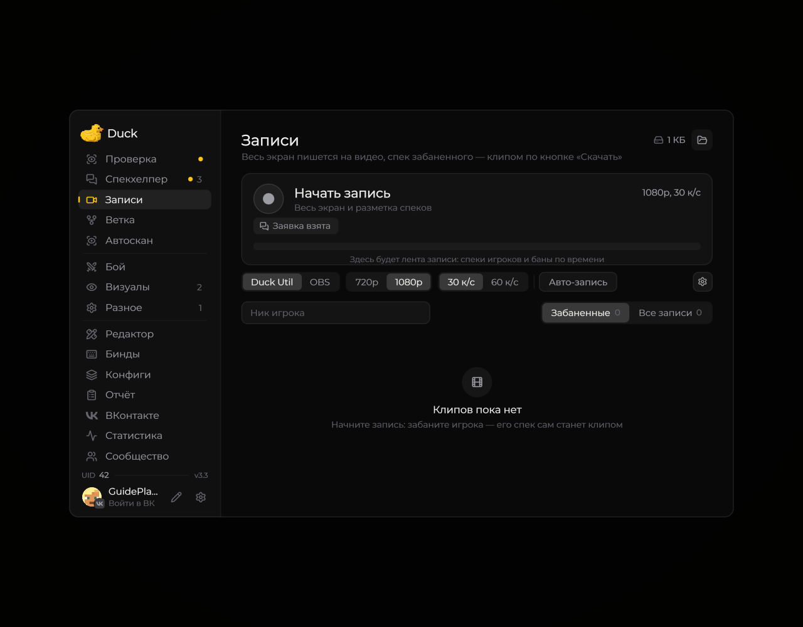
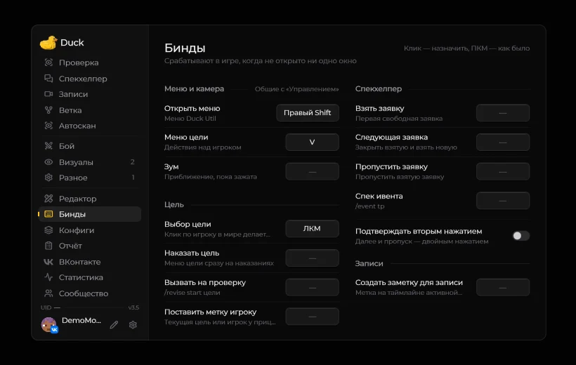

# Запись экрана

Duck Util содержит инструменты для сохранения игровых событий. Доступность записи, автоматических клипов и интеграции с OBS зависит от версии мода и ваших настроек.

<figure><figcaption>
Записи: управление записью и настройки · Duck Util 3.3. Демонстрационные данные.
</figcaption></figure>

Откройте раздел **Records** в меню Duck Util, чтобы посмотреть доступные функции и записи. Перед длительной записью проверьте свободное место на диске и параметры сохранения.

## Запись во время смены

При включённой по умолчанию **«Авто-записи смены»** видео начинается на FunTime после того, как мод увидит подтверждённую смену. Запись продолжается между заявками. По окончании нажмите **«Закончить запись»**. Переключатель находится на странице [«Записи»](../nastroika/records-screen.md) под шестерёнкой.

## Заметки во время записи

В меню **«Бинды» → «Записи»** назначьте клавишу **«Создать заметку для записи»**. По умолчанию клавиши нет. Нажмите её в игре во время активной записи, чтобы отметить текущий момент. Метки сохраняются вместе с разметкой, отображаются цветом темы на шкале и доступны в новых клипах, которые включают отмеченные моменты. В уже созданные клипы заметки задним числом не добавляются.

[Плеер и апелляции в разделе «Записи»](../nastroika/records-screen.md)
