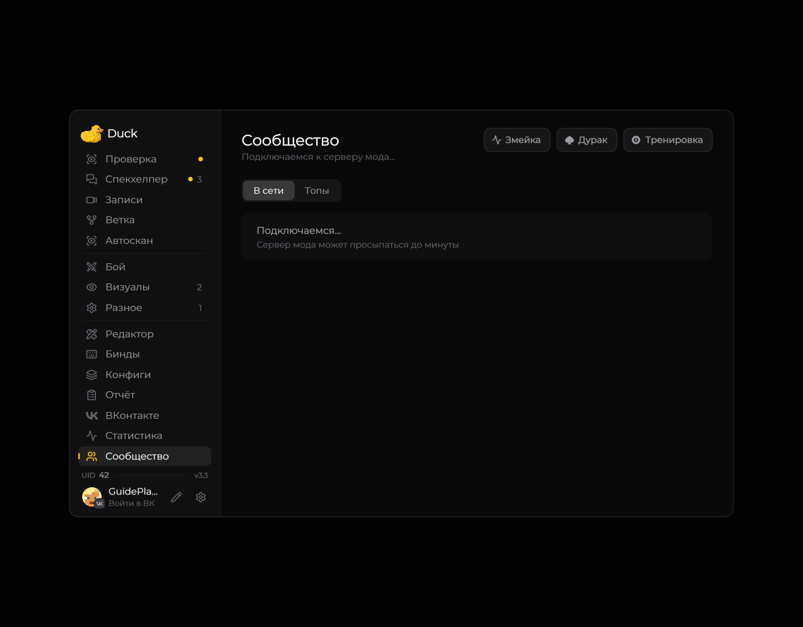

# Социальные функции

В Duck Util есть экран социальных функций, игровые активности и дополнительные сетевые возможности. Состав разделов зависит от версии мода и подключённых сервисов.

<!-- screenshots-3.3 -->
<figure><figcaption>
Сообщество и действия с модераторами · Duck Util 3.3. Демонстрационные данные.
</figcaption></figure>

[Посмотреть встроенные игры](games.md)
<!-- /screenshots-3.3 -->

Откройте социальную страницу из меню Duck Util. Если сведения или игры не загружаются, проверьте подключение к интернету, статус входа и подсказки на экране. Сетевые функции могут требовать активную лицензию.

Встроенные игры могут взаимодействовать с другими пользователями Duck Util. Их доступность и результаты зависят от состояния сервиса.
